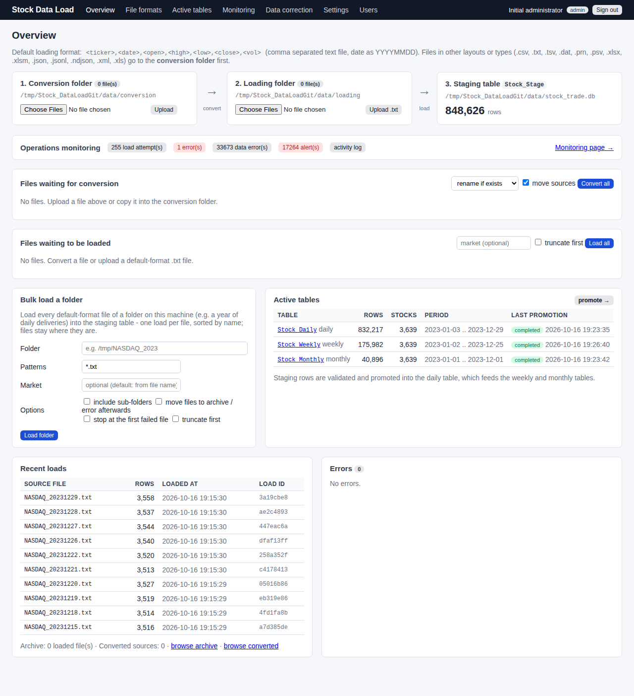
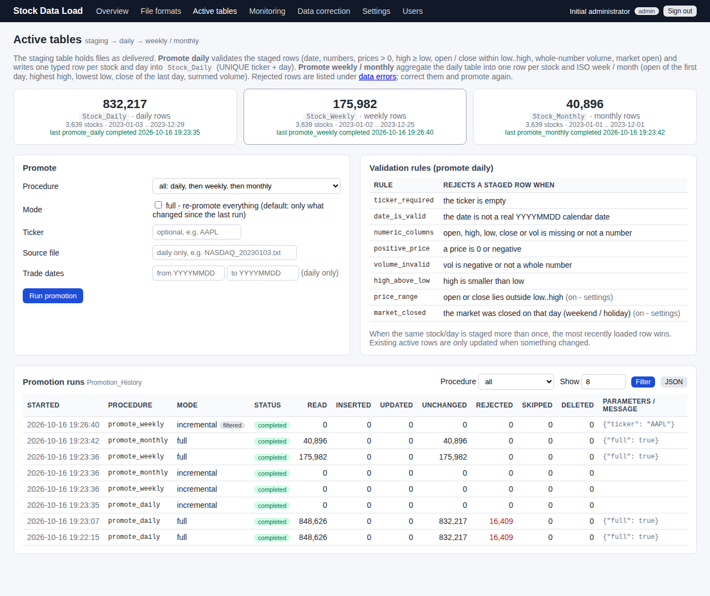
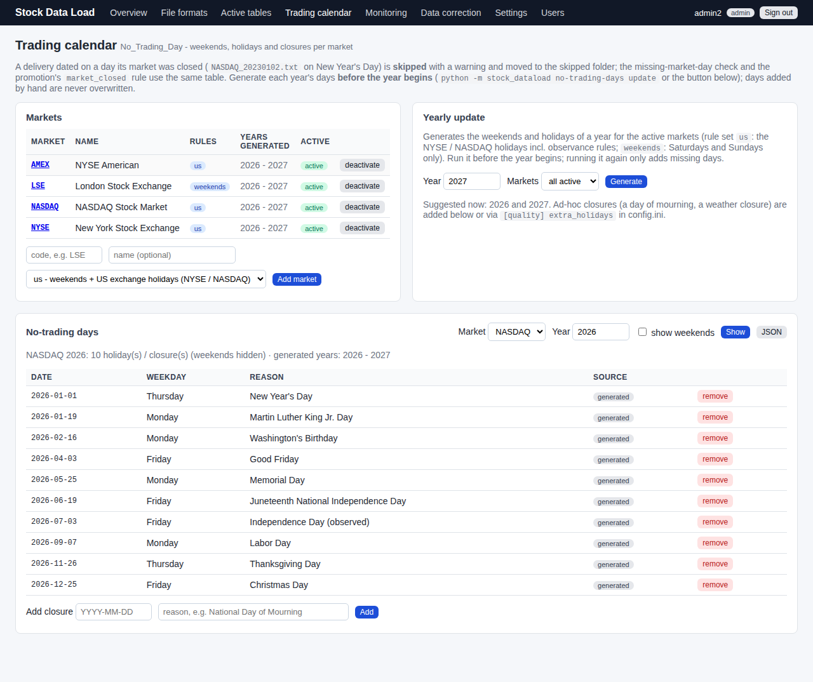
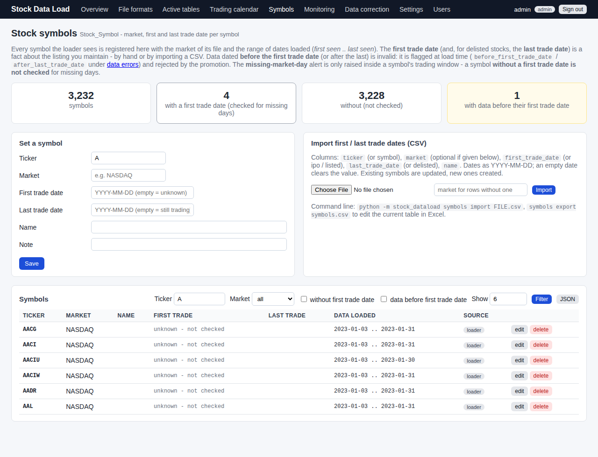
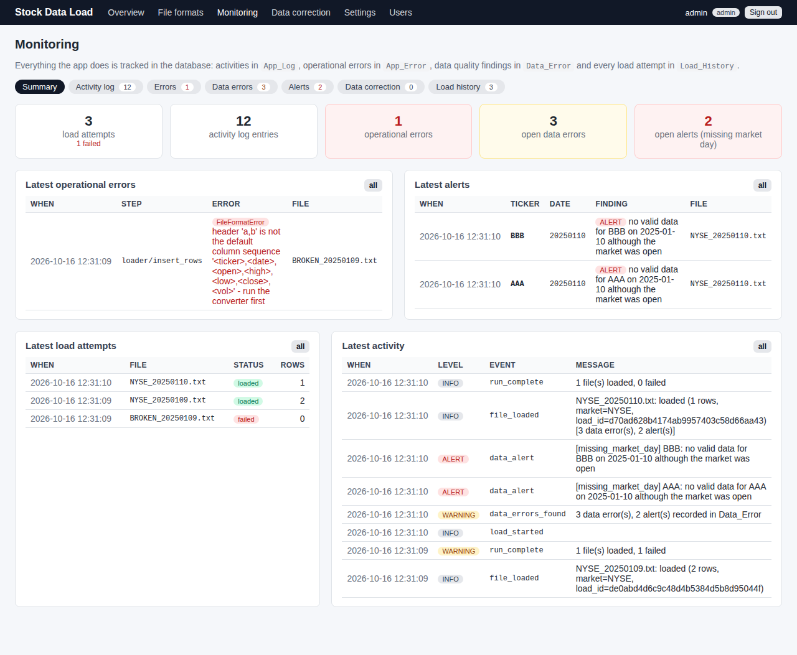
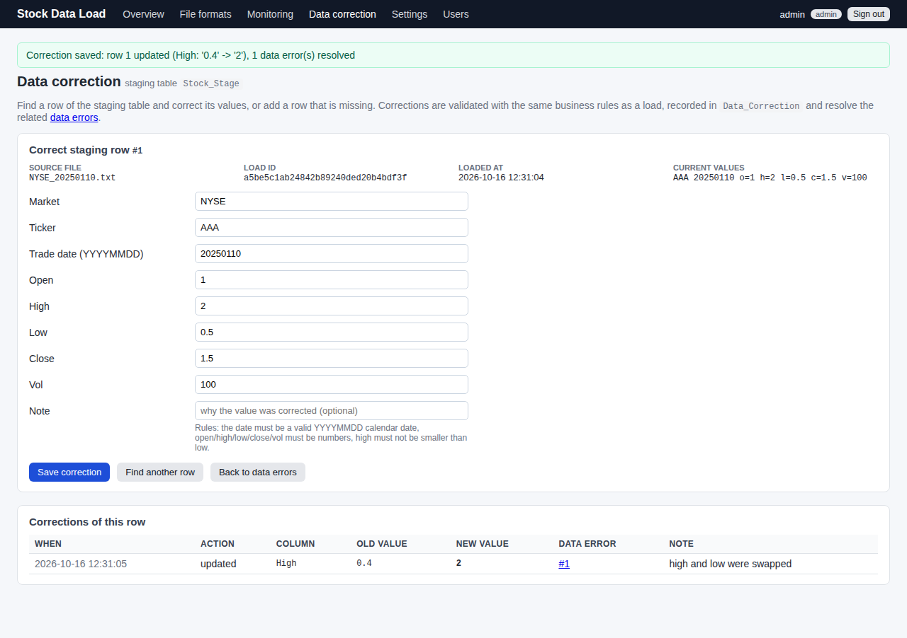
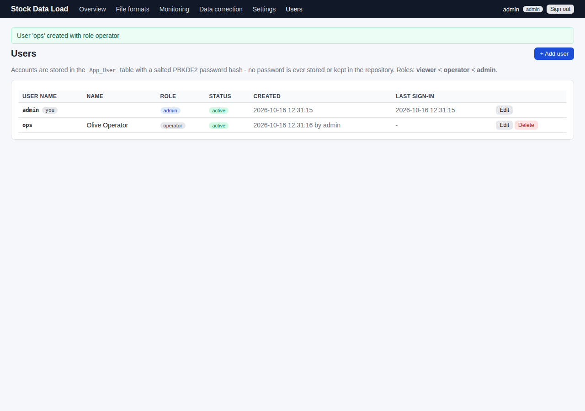
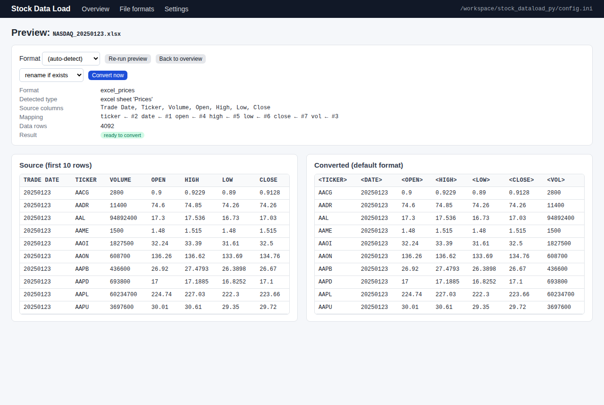
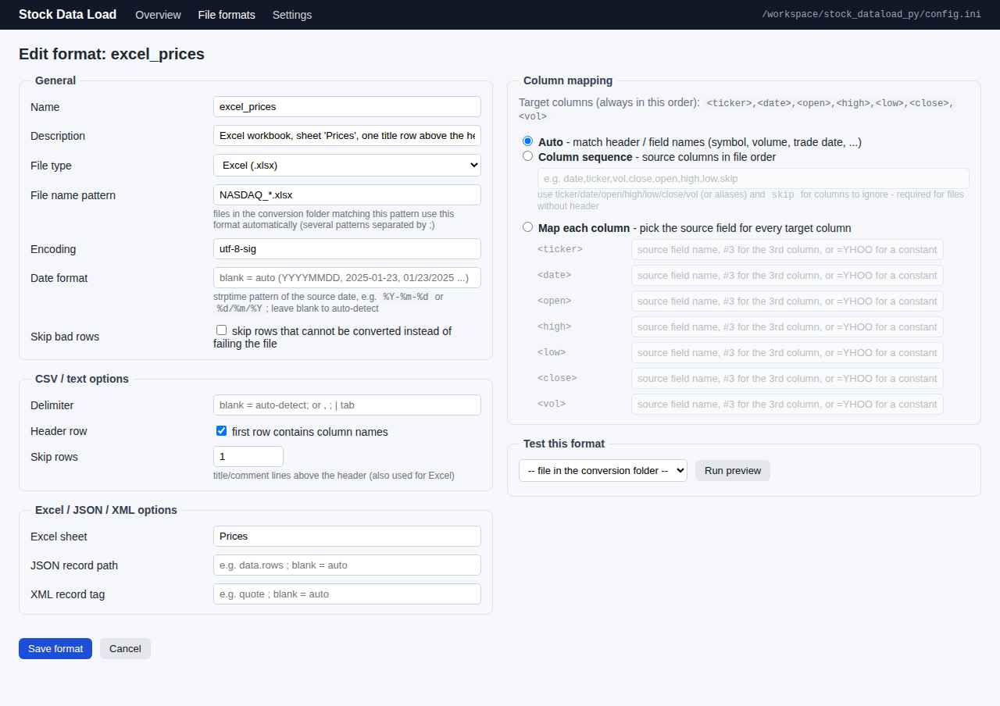
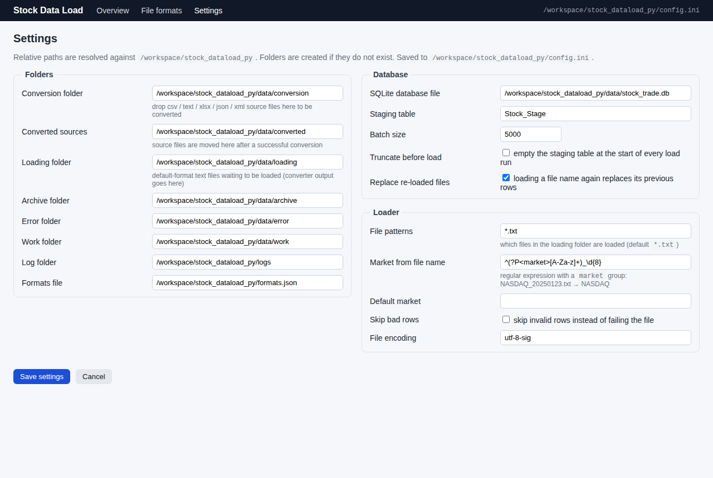

# stock_dataload

Loads daily stock trading files (e.g. `NASDAQ_20250123.txt`) from a **loading
folder** - or **every file of any folder in one go** - into a SQLite **staging
table**. Files delivered in other layouts or file types (**CSV, delimited
text, Excel, JSON, XML**) are first **converted** to the default layout.
Deliveries dated on a day the market was closed are **skipped** (a
**trading calendar** table knows every weekend, holiday and closure per
market), and a **stock symbol table** knows which market each symbol trades
on and since when - data before a stock's first trade date is invalid, and a
stock is only expected to deliver inside its trading window. Staged rows are
**validated and promoted** into the **active tables**: one typed row per
stock and day, and weekly / monthly aggregates. A **web dashboard** lets
business users manage file formats, folders, loads, promotions, the trading
calendar and the symbol table, and **monitor** the activity log, errors and
data quality findings.

```
  conversion folder           loading folder / any folder          database
  csv / text / xlsx  convert  <ticker>,<date>,<open>,     load              promote      Stock_Daily
  json / xml, any   ───────►  <high>,<low>,<close>,<vol> ───────► Stock_Stage ───────►  Stock_Weekly
  column sequence             always a .txt text file             (as delivered)        Stock_Monthly
```

Python port of the `Stock_DataLoad` SSIS package.

---

## 1. Installation

Requires **Python 3.10+**. Everything is installed into the project's own
virtual environment (`.venv`) – nothing is installed globally.

### Windows (Command Prompt or PowerShell)

```bat
cd Stock_DataLoadGit
py -m venv .venv
.venv\Scripts\activate
python -m pip install -r requirements.txt
python -m stock_dataload --help
```

* `py` is the Python launcher that comes with the python.org installer.
  If `py` is not found, use `python -m venv .venv`.
  (`python3` is **not** a Windows command – it only opens the Microsoft
  Store alias, which is why `python3 -m venv .venv` fails.)
* Paths on Windows use `.venv\Scripts\...`, not `.venv/bin/...`.
* PowerShell may refuse to run `activate` ("running scripts is disabled").
  Run once: `Set-ExecutionPolicy -Scope CurrentUser RemoteSigned`, then
  `.venv\Scripts\Activate.ps1`.
* Without activating the venv, call the tools by their full path instead:
  `.venv\Scripts\python -m pip install -r requirements.txt` and
  `.venv\Scripts\python -m stock_dataload --help`.

### macOS / Linux

```bash
cd Stock_DataLoadGit
python3 -m venv .venv
source .venv/bin/activate
python -m pip install -r requirements.txt
python -m stock_dataload --help
```

(Without activating: `.venv/bin/python -m pip install -r requirements.txt`,
`.venv/bin/python -m stock_dataload --help`.)

All commands below assume the venv is **activated** (`(.venv)` shows in the
prompt), so `python` is the venv's Python on every platform.

What gets installed: `flask` (dashboard), `openpyxl` (Excel files),
`coverage` and `playwright` (tests). Converting csv/text/json/xml and
loading need the standard library only.

---

## 2. Quick start

```bash
python -m stock_dataload init-db                        # create the tables (data/stock_trade.db) + this and next
                                                        # year's no-trading days (weekends + holidays) for NASDAQ, NYSE, AMEX

# load a default-format file
copy samples\NASDAQ_20250123.txt data\loading\          # Windows   (cp ... on macOS/Linux)
python -m stock_dataload load
#   NASDAQ_20250123.txt: loaded (4092 rows, market=NASDAQ, load_id=...)

# a file in another layout / file type: convert it first (result lands in data/loading/)
python -m stock_dataload convert samples/NASDAQ_20250123.xlsx samples/NASDAQ_20250123.json --rename
python -m stock_dataload load

# or put files into data/conversion/ and convert the whole folder
python -m stock_dataload convert-folder

# bulk load: every default-format file of a folder (files stay where they are);
# deliveries dated on a no-trading day are skipped with a warning
python -m stock_dataload load-folder ../NASDAQ_2023
#   WARNING  NASDAQ_20230102.txt skipped: NASDAQ was closed on 2023-01-02 (New Year's Day (observed)) - no trading day, file not loaded
#   NASDAQ_20230102.txt: skipped - NASDAQ was closed on 2023-01-02 (New Year's Day (observed)) - ...
#   NASDAQ_20230103.txt: loaded (3200 rows, market=NASDAQ, load_id=...)
#   ...
#   ../NASDAQ_2023: completed - 250 of 255 file(s) loaded (832,217 rows), 5 skipped (no trading day) ... in 29.8s

# promote the staged rows into the active tables (validated daily rows, weekly + monthly aggregates)
python -m stock_dataload promote all
#   promote_daily: completed (full) - 832,217 rows read: 832,217 inserted, 0 updated, 0 unchanged into Stock_Daily in 21.8s
#   promote_weekly: completed (full) - 175,982 rows read: 175,982 inserted, ..., 7,070 incomplete (a trading day missing - see data errors) into Stock_Weekly in 5.5s
#   promote_monthly: completed (full) - 40,896 rows read: 40,896 inserted, ..., 3,100 incomplete (...) into Stock_Monthly in 6.5s

# the trading calendar: generate next year's no-trading days before the year begins
python -m stock_dataload no-trading-days update --year 2027
python -m stock_dataload no-trading-days list NASDAQ --year 2027

# the symbol table: when did a stock start to trade? (data before that day is invalid,
# and a stock without a first trade date is not checked for missing days)
python -m stock_dataload symbols set HCMAU --first-trade-date 2025-08-01 --name "HCM III Acquisition Corp units"
python -m stock_dataload symbols import listings.csv          # ticker, market, first_trade_date, last_trade_date, name
python -m stock_dataload symbols list --suspicious            # symbols with loaded data before their first trade date

# what happened?
python -m stock_dataload status
python -m stock_dataload logs
python -m stock_dataload data-errors --alerts
python -m stock_dataload promotions

# or do all of this in the browser
python -m stock_dataload dashboard                      # http://127.0.0.1:8050
```

All commands accept `--config FILE`, `-v` (debug) and `-q` (quiet).

---

## 3. Dashboard

```bash
python -m stock_dataload dashboard            # host/port in config.ini [dashboard]
```

### Signing in – the initial administrator

Every page requires a signed-in user. **No account or secret is shipped with
the repository**; create the first administrator in one of two ways:

```bash
# a) before the first start - prompts for the password (nothing is echoed or stored in clear text)
python -m stock_dataload user add admin --role admin

# b) just start the dashboard: with an empty user table it creates 'admin' with a random
#    ONE-TIME password that is printed to the console (or set STOCK_DATALOAD_ADMIN_PASSWORD)
python -m stock_dataload dashboard
#   ========================================================================
#     Initial administrator created: username 'admin'
#     One-time password: Xk7pQ2...            <- change it at the first sign-in
#   ========================================================================
```

Sign in at `http://127.0.0.1:8050/login`; the initial administrator has to
choose a new password first, then adds further users on the **Users** page.

| Role | May |
|------|-----|
| `viewer` | read the overview, formats and every monitoring page / JSON api |
| `operator` | + upload, convert, load, bulk load a folder, promote, delete files, edit formats, data correction, generate / edit no-trading days, edit / import stock symbols |
| `admin` | + settings, user management (add / edit / disable / delete users, reset passwords), add markets to the calendar |

Users can change their own password under their name in the header. All
sign-ins, failed attempts, denied actions and user changes are written to
`App_Log` (component `auth`).

Passwords are stored only as salted **PBKDF2-HMAC-SHA256** hashes in the
`App_User` table. The session-signing secret is read from
`STOCK_DATALOAD_SECRET` or generated once into the git-ignored
`data/.secret_key` file – nothing secret ever lives in the repository.
The same accounts can be managed from the command line:

```
python -m stock_dataload user list
python -m stock_dataload user add NAME [--role viewer|operator|admin] [--name "Full Name"] [--must-change]
python -m stock_dataload user passwd NAME          # password: prompt, --password, or $STOCK_DATALOAD_PASSWORD
python -m stock_dataload user role NAME ROLE | enable NAME | disable NAME | delete NAME
```

| Page | What you do there |
|------|-------------------|
| **Overview** | the pipeline *conversion folder → loading folder → staging table*: upload files, pick a format per file (a matching custom format is pre-selected), **Convert** / **Preview** / **Load**, **bulk load a folder**, the active tables at a glance, recent loads, error reports, and a **monitoring strip** with the current error / alert counts. |
| **Trading calendar** | the markets a calendar is kept for (NASDAQ, NYSE, AMEX - add your own) and their no-trading days per year: weekends, holidays, ad-hoc closures. Generate a year (run before the year begins), add / remove closures, browse by market and year. JSON: `/api/no-trading-days?market=NASDAQ&year=2026`. |
| **Symbols** | the stock symbol table: every symbol the loader has seen with its market and the dates loaded; set or import (CSV) the first / last trade date; find symbols without a first trade date (not checked for missing days) or with data before their first trade date. JSON: `/api/symbols?ticker=HC`. |
| **Active tables** | run the promotion procedures (*staging → daily*, *daily → weekly / monthly*; incremental or full, optionally for one stock / file / date range), the validation rules, row counts and periods of `Stock_Daily` / `Stock_Weekly` / `Stock_Monthly`, the run history (`Promotion_History`) and a browser for each table (`/active/daily?ticker=AAPL`). JSON: `/api/promotions`, `/api/active/<daily|weekly|monthly>`. |
| **File formats** | create / edit / clone / delete custom formats: file type, file-name pattern, delimiter, header, rows to skip, date format, encoding, Excel sheet, JSON record path, XML record tag and the column mapping. **Run preview** tests a format before saving. |
| **Monitoring** | summary with totals; **activity log** (`App_Log`, filter by level / component); **errors** (`App_Error`, failing step + expandable stack trace); **data errors** and **alerts** (`Data_Error`, filter by file / alerts only / open only, each with a **Correct** link); **load history** (`Load_History`). JSON: `/api/logs`, `/api/errors`, `/api/data-errors`, `/api/history`, `/api/corrections`, `/api/monitor`, `/api/status`. |
| **Data correction** | fix a row of the staging table: find it by stage id, ticker / trade date / market / source file – or click **Correct** on a data error, which opens the page with that row populated. Values are validated with the same business rules as a load; a row that is missing (e.g. a missing-market-day alert or a rejected line) can be added. Every change is tracked in `Data_Correction` (old / new value per column, note) and the related data errors are marked **resolved**. |
| **Settings** (admin) | conversion / loading / other folders, SQLite file, staging table, formats file, loader options. Saved to `config.ini`. |
| **Users** (admin) | add users with a role and an initial password (optionally to be changed at the first sign-in), edit name / role / active status, reset passwords, delete accounts. The last active administrator cannot be demoted, disabled or deleted. |

The dashboard calls the same `FileConverter` / `StageLoader` classes as the
CLI – everything it does can also be scripted or scheduled.









<details>
<summary>More screenshots: preview, format editor, settings</summary>




</details>

---

## 4. Loading (`load`)

```
python -m stock_dataload load                      # every *.txt in data/loading/
python -m stock_dataload load path/to/file.txt     # specific file(s)
    --market NYSE        Market value for all rows (default: from the file name)
    --truncate           empty the staging table before loading
    --skip-bad-rows      skip invalid rows (written to data/error/<file>.rejects.txt)
    --keep               leave files where they are instead of moving them
    --include-no-trading-days   load files dated on a no-trading day too (default: skip them)
```

The loader only accepts the **default format** – comma separated, one
header row, dates as `YYYYMMDD`:

```
<ticker>,<date>,<open>,<high>,<low>,<close>,<vol>
AACG,20250123,0.9,0.9229,0.89,0.9128,2800
```

Per file: sha-256 fingerprint → header check → row validation → **delete the
file's previous rows + insert the new rows in one transaction** → data
quality checks → move to `data/archive/` (success) or `data/error/`
(failure, with a `.error.txt` report and a full rollback). Exit code is 1 if
any file failed – handy for schedulers.

**Re-loading a file.** If a file with the same name was loaded before, its
rows are deleted from the staging table and the file is loaded again – in
the same transaction, so a broken re-delivery rolls back and the previous
copy stays. No matter how often a file is loaded, exactly **one copy** (the
latest delivery) is in the staging table. Every attempt is recorded in
`Load_History` (`loaded` / `replaced` / `failed`).

`Market` is derived from the file name (`NASDAQ_20250123.txt` → `NASDAQ`,
regex in `config.ini`) unless `--market` is given.

**No-trading days.** The trade date is taken from the file name as well
(`NASDAQ_20250123.txt` → 2025-01-23, `[loader] date_from_filename_regex`).
A delivery dated on a day its market was closed - a weekend, a holiday or an
ad-hoc closure listed in the `No_Trading_Day` table (section 6) - is
**skipped**: a WARNING is logged at file level (console, log file and
`App_Log` event `file_skipped`), the attempt is registered in `Load_History`
with status `skipped`, and the file is moved to `data/skipped/` instead of
the archive. Nothing of it reaches the staging table. A skipped file is not a
failure (exit code stays 0). To load such a file anyway use
`--include-no-trading-days` (or turn the check off with `[loader]
skip_no_trading_days = false`).

```
WARNING  NASDAQ_20230102.txt skipped: NASDAQ was closed on 2023-01-02 (New Year's Day (observed)) - no trading day, file not loaded
```

### Bulk loading a folder (`load-folder`)

```
python -m stock_dataload load-folder FOLDER          # every *.txt in FOLDER, sorted by name
    --pattern GLOB       file pattern(s), repeatable (default: [loader] file_patterns = *.txt)
    --recursive          include sub-folders
    --market NYSE        Market value for all rows (default: from each file name)
    --move               move files to data/archive/ (loaded) or data/error/ (failed) - default: leave them
    --truncate           empty the staging table before the first file
    --skip-bad-rows      skip invalid rows instead of failing the file
    --stop-on-error      stop at the first file that fails (default: continue with the next file)
    --promote            afterwards run 'promote all' (incremental)
    --include-no-trading-days   load files dated on a no-trading day too (default: skip them)
```

`load-folder` is the same per-file load as above, applied to a whole folder -
a year of daily deliveries in one command. Each file is one transaction and one
`Load_History` row; a broken file is recorded (`App_Error`, `Load_History`
status `failed`, `.error.txt` report when `--move` is used) and **does not stop
the others**. Results are printed as the files complete, followed by a summary:

```
../NASDAQ_2023: completed - 250 of 255 file(s) loaded (832,217 rows), 5 skipped (no trading day), 17264 data error(s) / 17264 alert(s) in 29.8s
```

What can go wrong, and what happens:

| Problem | Handling |
|---------|----------|
| folder missing / not a folder / unreadable / no pattern | `LoadError` with a clear message (exit code 1), recorded in `App_Error` (`bulk_load_folder`) |
| no matching files | summary `completed` with a note, exit code 0 |
| a file is dated on a no-trading day of its market (`NASDAQ_20230102.txt` - New Year's Day) | skipped with a warning, `Load_History` status `skipped`, not a failure |
| a file is empty, has the wrong header, a bad row, an unreadable encoding, no read permission | that file fails and is rolled back; the run continues (`--stop-on-error` stops it); exit code 1 |
| the same content delivered twice under two names | loaded (it is a separate delivery) with a `duplicate_content` warning in `App_Log`; the promotion keeps the most recently loaded copy |
| the same file name loaded again | its previous rows are replaced (one copy per file), as for a single load |
| the database cannot be opened / is locked | `DatabaseError`, recorded, exit code 1 |
| Ctrl-C | the file being loaded is rolled back, the summary says `interrupted after N of M file(s)`, exit code 130 |

The summary is also written to `App_Log` (`bulk_load_started` /
`bulk_load_complete` with the counts). The same form is on the dashboard's
Overview page (*Bulk load a folder*).

**Tested with a whole year**: the 255 `NASDAQ_2023` files load in about
30 s - 250 files / 832,217 rows loaded, the 5 files dated on market holidays
(2 Jan, 16 Jan, 7 Apr, 29 May, 19 Jun - placeholder deliveries with zero
volume) skipped (`tests/test_nasdaq_2023.py`; the full year runs with
`STOCK_DATALOAD_FULL_YEAR=1`). The missing-market-day check is kept exact
and cheap for bulk runs by remembering the known tickers per file across the
run instead of re-scanning the growing staging table after every file.

---

## 5. Converting (`convert`, `convert-folder`, `inspect`, `formats`)

| Source | Extensions | Notes |
|--------|------------|-------|
| CSV / delimited text | `.csv .txt .tsv .dat .prn .psv` | delimiter auto-detected (`, ; \| tab`), optional header, title rows |
| Excel | `.xlsx .xlsm` | sheet by name or number, title rows, numeric / date cells |
| JSON | `.json .jsonl .ndjson` | list of objects, nested objects (`prices.open`), `record_path`, JSON lines |
| XML | `.xml` | one element per record (`record_tag`), attributes and child elements |

Whatever the source, the output is always a default-format `.txt` file in
the loading folder.

```
python -m stock_dataload convert SOURCE [SOURCE ...]
    --format NAME            use a saved format (formats.json / dashboard)
    --type excel             source type: auto (default) csv text excel json xml
    --columns date,ticker,vol,close,open,high,low    source column sequence ('skip' ignores a column)
    --map ticker=Symbol,date=#7,open=Open,...        map each target column to a field, #position or =constant
    --delimiter ';'  --no-header  --skip-rows 1  --date-format %d/%m/%Y  --encoding cp1252
    --sheet Prices  --record-path data  --record-tag quote
    --output-name X.txt  --overwrite | --rename  --move-source  --no-move  --skip-bad-rows
python -m stock_dataload convert-folder [--format NAME] [--on-conflict rename|overwrite|error] [--keep-source]
python -m stock_dataload inspect SOURCE        dry run: detected type, mapping, first converted rows
python -m stock_dataload formats               list the saved formats
```

How columns are mapped (CLI and dashboard alike):

1. an explicit **column map** (`--map`) – source field name, `#n` position or
   `=VALUE` constant (e.g. `ticker==YHOO` for files without a ticker column);
2. else an explicit **column sequence** (`--columns`);
3. else header names / JSON keys / XML tags are matched against the alias
   table in `formats.COLUMN_ALIASES` (`Symbol`→ticker, `Volume`→vol,
   `Trade Date`→date, …). Unknown columns are ignored; all seven default
   columns must be found.

Files in the conversion folder are matched against the **file pattern** of
each saved format (`NASDAQ_*.xlsx` → `excel_prices`). Output is written to
`data/work/` and only moved into `data/loading/` when complete; name clashes
are resolved by renaming (`NASDAQ_20250123_json.txt`).

The `samples/` folder holds `NASDAQ_20250123.txt` and the same data as csv,
tsv, `;`-delimited, pipe/no-header, xlsx, json and xml – converting any of
them yields a file byte-identical to the original (verified by the tests).

---

## 6. Trading calendar: no-trading days (`no-trading-days`)

The `No_Trading_Day` table lists **every day a market is closed** - weekends
as well as holidays and ad-hoc closures - one row per market and date, with
the reason and where the row came from:

```
Market   TradeDate    Reason                                  Source
NASDAQ   2023-01-01   weekend (Sunday)                        generated
NASDAQ   2023-01-02   New Year's Day (observed)               generated
NASDAQ   2025-01-09   National Day of Mourning                manual
NASDAQ   2025-06-05   configured closure ([quality] extra_holidays)   config
```

The `Market` table lists the markets a calendar is kept for, each with the
rule set used to generate its days: `us` = weekends + the NYSE / NASDAQ
holidays (New Year's Day, Martin Luther King Jr. Day, Washington's Birthday,
Good Friday, Memorial Day, Juneteenth, Independence Day, Labor Day,
Thanksgiving, Christmas, with the Saturday → Friday / Sunday → Monday
observance rules), or `weekends` = Saturdays and Sundays only (holidays are
added by hand). **NASDAQ, NYSE and AMEX are created automatically**; other
markets can be added at any time. The market of a delivery is the one in its
file name (`LSE_20250704.txt` → `LSE`).

```
python -m stock_dataload no-trading-days update                  # generate this year and next year (all active markets)
python -m stock_dataload no-trading-days update --year 2027      # one year   (--from 2023 --to 2027: a range)
python -m stock_dataload no-trading-days update --market LSE     # one market only
python -m stock_dataload no-trading-days list NASDAQ --year 2026 [--all]      # holidays / closures (--all: weekends too)
python -m stock_dataload no-trading-days check NASDAQ 2026-01-01              # "NASDAQ is CLOSED on 2026-01-01 (New Year's Day)"
python -m stock_dataload no-trading-days add NASDAQ 2025-01-09 --reason "National Day of Mourning"
python -m stock_dataload no-trading-days remove NASDAQ 2025-01-09
python -m stock_dataload no-trading-days markets
python -m stock_dataload no-trading-days add-market LSE --name "London Stock Exchange" --rules weekends
python -m stock_dataload no-trading-days disable LSE | enable LSE
```
(`calendar` is an alias of `no-trading-days`.)

**Yearly update.** `no-trading-days update` is the function to run **before a
year begins** (e.g. every December from a scheduler; `init-db` runs it for the
current and the next year). It only adds missing days - rows generated earlier
and rows added by hand are never overwritten, so a closure entered on the
command line or the dashboard survives re-runs. Ad-hoc closures can also be
listed in `config.ini` (`[quality] extra_holidays`); they are picked up by the
update (source `config`) and apply immediately even before it runs. Should a
year be looked up that was never generated, it is generated on the spot and a
warning asks you to run the update.

The table is the single source of truth for "was the market open?":

| Used by | Effect |
|---------|--------|
| the loader (section 4) | a delivery dated on a no-trading day is **skipped** with a WARNING, `Load_History` status `skipped`, file moved to `data/skipped/` |
| the `missing_market_day` quality check | nobody is expected to deliver on a closed day; every other day, every known stock must |
| `promote daily` (section 8) | staged rows dated on a closed day are rejected (`market_closed`, with the reason: *NASDAQ was closed on 2023-01-02 (New Year's Day (observed))*) |

Files without a recognisable market in their name are judged by the US
rules. DDL for reference: `sql/create_no_trading_day_sqlite.sql`.

---

## 7. Stock symbols: which market, since when (`symbols`)

The `Stock_Symbol` table has one row per symbol and market: the first day it
traded and, for delisted stocks, the last. The loader **registers every
symbol it loads** (source `loader`) with the market of the file and the range
of trade dates loaded (`FirstSeen .. LastSeen`); the first / last trade dates
are facts about the listing that you maintain:

```
Ticker   Market   FirstTradeDate   LastTradeDate   FirstSeen     LastSeen      Source
AAPL     NASDAQ   1980-12-12                       2023-01-03    2023-12-29    import
HCMAU    NASDAQ   2025-08-01                       2023-01-23    2023-12-04    manual      <- data before the listing!
ZYXI     NASDAQ                                    2023-01-03    2023-12-29    loader
```

```
python -m stock_dataload symbols set HCMAU --first-trade-date 2025-08-01 [--market NASDAQ] [--last-trade-date D] [--name N]
python -m stock_dataload symbols import listings.csv [--market NASDAQ]   # columns: ticker, market, first_trade_date, last_trade_date, name
python -m stock_dataload symbols export symbols.csv                      # edit in Excel, import again
python -m stock_dataload symbols list [--ticker HC] [--market NASDAQ] [--missing-dates] [--suspicious]
python -m stock_dataload symbols show HCMAU
python -m stock_dataload symbols delete HCMAU
```

What the dates mean:

| Situation | Effect |
|-----------|--------|
| a loaded row is dated **before the first trade date** (or after the last) | the row is **invalid**: flagged at load time (`Data_Error` rule `before_first_trade_date` / `after_last_trade_date`, shown on the Monitoring and Symbols pages) and **rejected by `promote daily`** (`[promotion] check_trading_window`); a correction with such a date is refused too |
| a stock is absent on a day **before its first trade date** (or after its last) | correct - no data is expected, **no missing-market-day alert** |
| a stock has **no first trade date** in the table | the missing-market-day check is **skipped** for it - its absence is never an alert (until you record the date) |
| a stock is absent on an open day **inside** its window | `missing_market_day` alert, as before |

Example - the `NASDAQ_2023` deliveries carry the symbol HCMAU on 19 days,
but HCM III Acquisition Corp units did not start trading on the Nasdaq
Global Market until 1 August 2025. After
`symbols set HCMAU --first-trade-date 2025-08-01` those rows are flagged
(*HCMAU started to trade on 2025-08-01 - data for 2023-12-04 is before its
first trade date*), are not promoted, and the alert *no valid data for HCMAU
on 2023-12-21 although the market was open* is no longer raised. `symbols
list --suspicious` finds every symbol whose loaded data starts before its
first trade date. DDL for reference: `sql/create_stock_symbol_sqlite.sql`.

---

## 8. Active tables and promotion (`promote`)

The staging table holds files *as delivered* (every column text, one copy per
file). The **active tables** hold validated, typed data:

| Table | One row per | Unique constraint | Columns |
|-------|-------------|-------------------|---------|
| `Stock_Daily` | stock and trading day | `UNIQUE (Ticker, TradeDate)` | `Market`, `Ticker`, `TradeDate` (YYYY-MM-DD), `Open`, `High`, `Low`, `Close` (REAL), `Volume` (INTEGER), provenance `SourceFile` / `LoadId` / `StageId`, `PromotedAt`, `UpdatedAt` |
| `Stock_Weekly` | stock and ISO week (Monday–Sunday) | `UNIQUE (Ticker, WeekStart)` | `WeekStart`, `WeekEnd`, `ISOYear`, `ISOWeek`, `Open` (first trading day), `High` (highest), `Low` (lowest), `Close` (last trading day), `Volume` (sum), `TradingDays`, `ExpectedDays`, `MissingDays`, `MissingDates`, `Complete`, `FirstTradeDate`, `LastTradeDate`, … |
| `Stock_Monthly` | stock and calendar month | `UNIQUE (Ticker, MonthStart)` | `MonthStart`, `MonthEnd`, `Year`, `Month`, `Open`, `High`, `Low`, `Close`, `Volume`, `TradingDays`, `ExpectedDays`, `MissingDays`, `MissingDates`, `Complete`, `FirstTradeDate`, `LastTradeDate`, … |

All three also carry CHECK constraints (`High >= Low`, prices `> 0`, `Volume
>= 0`, ISO date format). DDL: `sql/create_stock_active_tables_sqlite.sql`.

### The procedures

SQLite has no stored procedures, so each promotion is implemented as a
**procedure** of `stock_dataload/promotion.py`: a fixed, set-based SQL script
that runs inside **one transaction** (`BEGIN IMMEDIATE … COMMIT`) - validation,
de-duplication, upsert and the row counts all happen in SQL; Python only
supplies the market calendar and the parameters. Every run is recorded in
`Promotion_History`; a failure rolls everything back, is recorded in
`App_Error` / `Promotion_History` (status `failed`) and raises
`PromotionError`. The exact SQL is exported to `sql/promote_daily_sqlite.sql`,
`sql/promote_weekly_sqlite.sql` and `sql/promote_monthly_sqlite.sql` (generated
from the module; a test keeps them in sync).

```
python -m stock_dataload promote daily            # staging -> Stock_Daily, with validation
python -m stock_dataload promote weekly           # Stock_Daily -> Stock_Weekly
python -m stock_dataload promote monthly          # Stock_Daily -> Stock_Monthly
python -m stock_dataload promote all              # daily, then weekly, then monthly
    --full                 re-promote everything (default: only what changed since the last run)
    --ticker AAPL          only this stock
    --file NASDAQ_20230103.txt   --load-id ID   --from 20230101 --to 20230131     (daily only)
python -m stock_dataload promotions [--procedure promote_daily] [--limit N]      # the run registry
python -m stock_dataload status                   # row counts / periods of the active tables
```

**`promote_daily`** (staging → daily) validates every staged row; the first
failing rule decides:

| Rule | Rejects the row when |
|------|----------------------|
| `ticker_required` | the ticker is empty |
| `date_is_valid` | the date is not a real `YYYYMMDD` (or `YYYY-MM-DD`) calendar date |
| `numeric_columns` | open, high, low, close or vol is missing or not a number |
| `positive_price` | a price is 0 or negative |
| `volume_invalid` | vol is negative or not a whole number |
| `high_above_low` | high is smaller than low |
| `price_range` | open or close lies outside low..high *(`[promotion] check_price_range`)* |
| `before_first_trade_date` / `after_last_trade_date` | the trade date lies outside the stock's trading window (`Stock_Symbol` table, section 7) *(`[promotion] check_trading_window`)* |
| `market_closed` | the market was closed on that day according to its `No_Trading_Day` calendar (section 6) *(`[promotion] reject_market_closed_days`)* |

Rejected rows are recorded in `Data_Error` (rule, column, value, message,
source file / load id - once per open finding), so they show up on the
monitoring pages and can be fixed on the **Data correction** page; the next
promotion picks the corrected rows up. Rows that pass are typed and
**upserted**: new stock/days are inserted, existing ones are updated only when
something changed (`UpdatedAt`). When the same stock/day is staged more than
once (two files, a manual row) the most recently loaded row wins
(`duplicates skipped` in the result). Without filters a run is **incremental**
- only stock/days loaded or corrected since the last completed run (the first
run, `--full` and filtered runs take everything they select).

**`promote_weekly` / `promote_monthly`** (daily → aggregates) compute, per
stock and period, the open of the first trading day, the highest high, the
lowest low, the close of the last trading day, the summed volume and the number
of trading days. Incremental runs recompute only the periods that contain daily
rows changed since the last run; `--full` recomputes every period and removes
aggregates whose daily rows are gone.

**Validation of the weekly / monthly data** (`[promotion] check_completeness`):
every *trading day* of the period must have a daily row. A trading day is a
day the market was open (`No_Trading_Day` table, section 6), inside the
stock's trading window if its first / last trade date is known (`Stock_Symbol`
table, section 7), between the earliest and the latest trade date loaded for
the market (days before the data history begins or after the latest delivery
cannot be missing - a week or month still in progress is not incomplete). If
**one trading day is missing, the week / month is a data error**: the
aggregate is still written from the days there are, but with

| Column | Meaning |
|--------|---------|
| `ExpectedDays` | trading days of the period |
| `MissingDays`, `MissingDates` | the expected days without a daily row, e.g. `1`, `2023-01-18` |
| `Complete` | `0` = a trading day is missing (`1` = complete) |

and a `Data_Error` finding (`incomplete_week` / `incomplete_month`, source
`Stock_Weekly` / `Stock_Monthly`, e.g. *AAPL week 2023-W03 (2023-01-16..2023-01-22)
is incomplete: 4 of 5 trading days loaded - missing 2023-01-18*). Load the
missing day and promote again: the aggregate becomes complete and the finding
is resolved automatically. Incomplete periods are listed with
`/active/weekly?incomplete=1` on the dashboard, `data-errors --file
Stock_Weekly` on the command line, and counted in `Promotion_History`
(`RowsIncomplete`). With the `NASDAQ_2023` deliveries 7,070 of the 175,982
weeks have a day missing (sporadically delivered symbols, listings and
delistings without recorded dates) - recording first / last trade dates in
the symbol table clears the ones that are not real gaps.

With the `NASDAQ_2023` deliveries: 832,217 staged rows (the five holiday
placeholder files are skipped by the loader, see section 4) → 832,217 daily
rows, 175,982 weekly and 40,896 monthly rows, verified against an independent
computation in `tests/test_nasdaq_2023.py`.

---

## 9. Monitoring: activity log, errors, data quality

Everything the app does is tracked in the database (next to the rotating
`logs/stock_dataload.log`) and shown on the dashboard's **Monitoring** pages:

| Table | Content | CLI |
|-------|---------|-----|
| `App_Log` | every activity: `load_started`, `reload_detected`, `previous_load_replaced`, `file_loaded`, `data_errors_found`, `data_alert`, `run_complete`, … (level, component, file, load id, JSON details) | `logs [--level ALERT] [--component loader]` |
| `App_Error` | every operational error with the **component and step** that failed (`check_file`, `previous_load_check`, `replace_rows`, `insert_rows`, `record_history`, `quality_check`, `archive_file`, conversion, CLI …), exception type and stack trace | `errors [--component loader]` |
| `Data_Error` | data quality findings (see below), rows rejected by `promote daily` and incomplete weeks / months (`incomplete_week` / `incomplete_month`), with rule, severity, `Alert` flag, ticker, date, column, value, line; `Resolved` once corrected / complete | `data-errors [--file NAME] [--alerts]` |
| `Data_Correction` | every change made on the **Data correction** page: action (updated / inserted), staging row, column, old / new value, linked data error, note | dashboard `/correct`, `/api/corrections` |
| `Load_History` | one row per load attempt: file name, sha-256 content hash, status (`loaded` / `replaced` / `failed` / `skipped`), rows, message | `history [--file NAME]` |
| `Promotion_History` | one row per promotion run: procedure, mode (full / incremental), parameters, rows read / inserted / updated / unchanged / rejected / skipped / deleted, status, message | `promotions [--procedure NAME]` |

All `logs` / `errors` / `data-errors` / `history` commands take `--limit N`.

### Data quality checks (strategy pattern)

After every successful load the rows are validated by pluggable business
rules (`stock_dataload/quality.py`). Findings do not fail the load (a staging
table lands data *as delivered*) but each one is recorded in `Data_Error`:

| Rule | Checks | Severity |
|------|--------|----------|
| `date_is_valid` | `date` is a real `YYYYMMDD` calendar date | error |
| `numeric_columns` | `open, high, low, close, vol` are numbers | error |
| `high_above_low` | on each row `high` is not smaller than `low` | error |
| `before_first_trade_date` | a row is not dated before the day the stock started to trade (`Stock_Symbol` table, section 7) | error |
| `after_last_trade_date` | a row is not dated after the day the stock stopped trading (delisting) | error |
| `missing_market_day` | every stock known from previous loads of the market has **valid** data for each day the **market was open** (`No_Trading_Day` table) **and that lies inside the stock's trading window** - a stock without a first trade date is not checked | **alert** |
| `row_format` | rows rejected by the loader itself | error |

Alerts are also written as `ALERT` entries to `App_Log` and as warnings to
the log file. Add or remove rules without touching the loader:

```python
from stock_dataload import StageLoader, load_settings
from stock_dataload.quality import DataQualityChecker, RowValidationStrategy, QualityIssue

class VolumeCapStrategy(RowValidationStrategy):
    name = "volume_cap"
    def validate_row(self, row, context):
        if float(row.values["vol"] or 0) > 1e10:
            return [QualityIssue(self.name, "volume looks wrong", line_no=row.line_no)]
        return []

checker = DataQualityChecker()               # the default rule set
checker.add_strategy(VolumeCapStrategy())    # add a rule
checker.remove_strategy("high_above_low")    # drop a rule
StageLoader(load_settings(), checker=checker).run()
```

Dataset-wide rules subclass `DatasetValidationStrategy` (see
`MissingMarketDayStrategy`).

---

## 10. Configuration (`config.ini`)

Edit in the dashboard (*Settings*) or by hand. Relative paths are resolved
against the folder containing `config.ini`; the file is found via
`--config`, `$STOCK_DATALOAD_CONFIG`, `./config.ini` or the project root.

| Section / key | Meaning |
|---------------|---------|
| `[paths] conversion_dir`, `loading_dir` | the conversion folder and the loading folder |
| `converted_dir`, `archive_dir`, `error_dir`, `skipped_dir`, `work_dir`, `log_dir` | see project layout |
| `[database] sqlite_path` | SQLite file (created on first use), default `data/stock_trade.db` |
| `stage_table`, `batch_size`, `truncate_before_load` | staging table name, rows per insert batch, truncate-and-load |
| `daily_table`, `weekly_table`, `monthly_table` | names of the active tables (`Stock_Daily`, `Stock_Weekly`, `Stock_Monthly`) |
| `[promotion] reject_market_closed_days` | `promote daily` rejects rows dated on a weekend / holiday (default true) |
| `check_price_range` | `promote daily` rejects rows whose open / close lies outside low..high (default true) |
| `check_trading_window` | `promote daily` rejects rows dated before the stock's first / after its last trade date (default true) |
| `check_completeness` | `promote weekly` / `monthly` mark periods with a trading day missing as data errors (default true) |
| `[quality] enabled` | run the data quality strategies after every load |
| `alert_missing_days` | missing-market-day alerts on/off |
| `extra_holidays` | ad-hoc market closures, comma separated `YYYY-MM-DD` |
| `[loader] file_patterns` | which files in the loading folder are loaded (`*.txt`) |
| `market_from_filename_regex`, `default_market` | how `Market` is derived from the file name |
| `skip_bad_rows`, `encoding` | loader options |
| `date_from_filename_regex`, `skip_no_trading_days` | how the trade date is read from the file name (`date` group) and whether deliveries dated on a no-trading day are skipped (default true) |
| `[formats] file` | JSON file holding the custom formats (`formats.json`) |
| `[dashboard] host`, `port` | where the dashboard listens (`127.0.0.1:8050`) |
| `secret_key_file` | where the generated session secret is kept (`data/.secret_key`, git-ignored); `$STOCK_DATALOAD_SECRET` overrides |

---

## 11. Database

One SQLite file (`data/stock_trade.db`); all tables are created
automatically (or by `init-db`). DDL for reference in `sql/`.

| Table | Columns |
|-------|---------|
| `Stock_Stage` | `StageId`, `Market`, `Ticker`, `TradeDate`, `Open`, `High`, `Low`, `Close`, `Vol` (all as delivered, text), `SourceFile`, `LoadId`, `LoadedAt` |
| `Stock_Daily` | `DailyId`, `Market`, `Ticker`, `TradeDate`, `Open`, `High`, `Low`, `Close`, `Volume`, `SourceFile`, `LoadId`, `StageId`, `PromotedAt`, `UpdatedAt` - `UNIQUE (Ticker, TradeDate)` |
| `Stock_Weekly` | `WeeklyId`, `Market`, `Ticker`, `WeekStart`, `WeekEnd`, `ISOYear`, `ISOWeek`, `Open`, `High`, `Low`, `Close`, `Volume`, `TradingDays`, `ExpectedDays`, `MissingDays`, `MissingDates`, `Complete`, `FirstTradeDate`, `LastTradeDate`, `PromotedAt`, `UpdatedAt` - `UNIQUE (Ticker, WeekStart)` |
| `Stock_Monthly` | `MonthlyId`, `Market`, `Ticker`, `MonthStart`, `MonthEnd`, `Year`, `Month`, `Open`, `High`, `Low`, `Close`, `Volume`, `TradingDays`, `ExpectedDays`, `MissingDays`, `MissingDates`, `Complete`, `FirstTradeDate`, `LastTradeDate`, `PromotedAt`, `UpdatedAt` - `UNIQUE (Ticker, MonthStart)` |
| `Market` | `Market`, `Name`, `Rules` (`us` / `weekends`), `Active`, `CreatedAt` |
| `No_Trading_Day` | `Market`, `TradeDate`, `Reason`, `Source` (`generated` / `config` / `manual`), `CreatedAt` - `UNIQUE (Market, TradeDate)` |
| `Stock_Symbol` | `Ticker`, `Market`, `Name`, `FirstTradeDate`, `LastTradeDate`, `FirstSeen`, `LastSeen`, `Source` (`loader` / `manual` / `import`), `Note`, `CreatedAt`, `UpdatedAt` - `UNIQUE (Market, Ticker)` |
| `Promotion_History` | `Procedure`, `TargetTable`, `Mode`, `Filtered`, `Parameters`, `StartedAt`, `FinishedAt`, `Status`, `RowsRead`, `RowsInserted`, `RowsUpdated`, `RowsUnchanged`, `RowsRejected`, `RowsSkipped`, `RowsDeleted`, `RowsIncomplete`, `Message` |
| `Load_History` | `FileName`, `FileHash`, `FileSize`, `LoadId`, `Market`, `Status`, `RowsLoaded`, `Message`, `LoadedAt` |
| `App_Log` | `LoggedAt`, `Level`, `Component`, `Event`, `SourceFile`, `LoadId`, `Message`, `Details` |
| `App_Error` | `OccurredAt`, `Component`, `Operation`, `SourceFile`, `LoadId`, `ErrorType`, `ErrorMessage`, `Stacktrace`, `Details` |
| `Data_Error` | `DetectedAt`, `SourceFile`, `LoadId`, `Market`, `Ticker`, `TradeDate`, `ColumnName`, `Value`, `Rule`, `Severity`, `Alert`, `ErrorMessage`, `LineNo`, `Resolved`, `ResolvedAt`, `ResolutionNote` |
| `Data_Correction` | `CorrectedAt`, `Action`, `StageId`, `SourceFile`, `Ticker`, `TradeDate`, `ColumnName`, `OldValue`, `NewValue`, `DataErrorId`, `Note` |
| `App_User` | `Username`, `DisplayName`, `PasswordHash` (PBKDF2), `Role`, `Active`, `MustChangePassword`, `CreatedAt`, `CreatedBy`, `LastLoginAt` |

Query with any SQLite tool, e.g. `sqlite3 data/stock_trade.db "select * from Stock_Stage limit 5"`
or `sqlite3 data/stock_trade.db "select * from Stock_Weekly where Ticker = 'AAPL' order by WeekStart"`.

---

## 12. Tests

```bash
python -m unittest discover -s tests -t . -v
python -m coverage run --source=stock_dataload -m unittest discover -s tests -t .
python -m coverage report -m                  # ~97% lines, every method covered
```

No external services are needed. `tests/test_nasdaq_2023.py` bulk loads and
promotes the real `NASDAQ_2023` deliveries (the folder next to the project, or
`$STOCK_DATALOAD_TEST_DATA`; January by default, the whole year with
`STOCK_DATALOAD_FULL_YEAR=1`) and is skipped when the folder is not there.
`tests/test_dashboard_browser.py` drives
the dashboard in a real headless Chromium via Playwright: run
`python -m playwright install chromium` once (or point
`PLAYWRIGHT_BROWSERS_PATH` at an existing Playwright browser cache); these
tests are skipped automatically if no browser can be launched.

---

## 13. Project layout

```
Stock_DataLoadGit/
├── config.ini                 settings (editable in the dashboard)
├── formats.json               custom file formats (editable in the dashboard)
├── requirements.txt
├── stock_dataload/            the package
│   ├── formats.py             default format + header alias table
│   ├── file_formats.py        FileFormat model + FormatStore (formats.json)
│   ├── readers.py             csv / text / excel / json / xml readers
│   ├── converter.py           any source -> default-format text file -> loading folder
│   ├── loader.py              loading folder / any folder (bulk) -> staging table
│   ├── promotion.py           active tables + the promote_daily / weekly / monthly procedures
│   ├── trading_calendar.py    No_Trading_Day / Market tables (weekends, holidays, closures per market)
│   ├── symbols.py             Stock_Symbol table (market, first / last trade date per symbol)
│   ├── db.py                  staging table + Load_History (SQLite)
│   ├── audit.py               App_Log / App_Error
│   ├── auth.py                users, roles, password hashing (App_User)
│   ├── quality.py             data quality strategies + Data_Error
│   ├── correction.py          data correction of staging rows + Data_Correction
│   ├── market_calendar.py     US market trading calendar
│   ├── config.py              config.ini handling
│   ├── cli.py                 python -m stock_dataload ...
│   └── dashboard/             Flask web dashboard
├── data/
│   ├── conversion/            THE CONVERSION FOLDER: source files in any supported format
│   ├── converted/             sources after a successful conversion
│   ├── loading/               THE LOADING FOLDER: default-format .txt files waiting to be loaded
│   ├── archive/               files loaded successfully
│   ├── error/                 files that failed + .error.txt / .rejects.txt reports
│   ├── skipped/               deliveries dated on a no-trading day (not loaded)
│   └── work/                  scratch space for the converter
├── samples/                   NASDAQ_20250123 as txt / csv / tsv / xlsx / json / xml
├── sql/                       DDL + procedure scripts for reference (generated from the package)
├── tests/                     unittest suite
└── logs/                      stock_dataload.log (rotating)
```

---

## 14. Scripting and scheduling

```python
from stock_dataload import load_settings, FileConverter, ConversionSpec, StageLoader, PromotionService

settings = load_settings()                     # finds config.ini
FileConverter(settings).convert("inbox/broker.csv", ConversionSpec(date_format="%Y-%m-%d"))
for result in StageLoader(settings).run():
    print(result)                              # broker.txt: loaded (4092 rows, ...)

summary = StageLoader(settings).load_folder("../NASDAQ_2023", progress=print)   # bulk load
print(summary.loaded, summary.failed, summary.rows_loaded, summary.failures)

promotions = PromotionService(settings)
daily = promotions.promote_daily()             # PromotionResult: rows_inserted / updated / rejected ...
print(daily, daily.reject_reasons)
promotions.promote_weekly(); promotions.promote_monthly()      # or promotions.promote_all()
print(promotions.fetch("weekly", ticker="AAPL", limit=5))

from datetime import date
from stock_dataload import TradingCalendar, SymbolRegistry
calendar = TradingCalendar(settings)
calendar.update_year(2027)                      # the yearly update (all active markets)
calendar.add_day("NASDAQ", "2027-03-03", "storm closure")
print(calendar.is_open("NASDAQ", date(2027, 7, 5)), calendar.closure_reason("NASDAQ", date(2027, 7, 5)))

symbols = SymbolRegistry(settings)
symbols.set("HCMAU", "NASDAQ", first_trade_date="2025-08-01")
print(symbols.import_csv("listings.csv"), symbols.find(suspicious=True))
```

`python -m stock_dataload load` / `load-folder` return 0 on success, 1 if
any file failed, 2 on a configuration error (130 when interrupted);
`promote` returns 1 if a procedure failed – run them from Windows Task
Scheduler / cron (using the venv's Python, e.g.
`C:\...\Stock_DataLoadGit\.venv\Scripts\python.exe -m stock_dataload load-folder D:\deliveries --promote`)
after the files have been dropped or converted. Schedule
`python -m stock_dataload no-trading-days update` once a year (e.g. in
December) so the next year's calendar is in place before the year begins.
