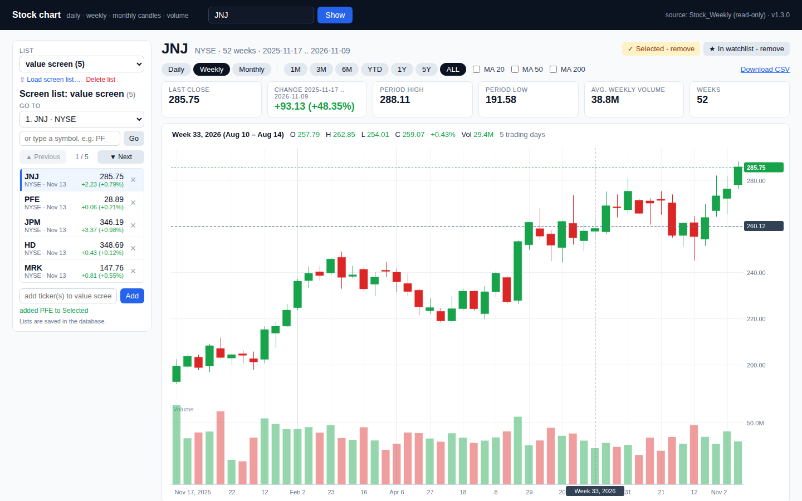
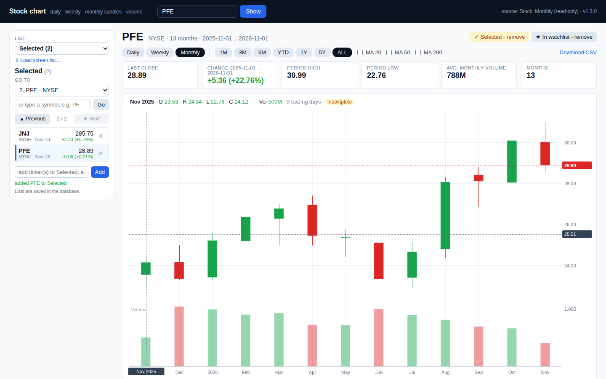

# Stock chart dashboard (`stock_chart`)

A standalone web dashboard that draws **candlestick charts** of the stock data - **daily, weekly or
monthly**: one candle per trading day, ISO week or calendar month (open, high, low, close) with the
**volume** underneath, for any ticker in the `Stock_Daily` table - and **stock lists** (a watchlist, screen
lists loaded from text files, your Selected stocks) to review one chart after the other.



It is a **separate application** from the data pipeline (`stock_dataload`): its own package, config
file, requirements, tests, process and port. It can be developed, tested, deployed, started, stopped
and upgraded on its own - it never imports the pipeline code and it only **reads** the stock data. The one
thing it writes are its own stock lists (`Chart_List`, `Chart_List_Item`).

```
 stock_dataload (pipeline, dashboard :8050, portal :8060)               chart_dashboard (this app, :8070)
   load / promote ──► data/stock_trade.db ── Stock_Daily ───────────────►  read-only  ──► browser: candlestick chart
                                           ├─ Stock_Weekly  (optional) ─►                 Daily | Weekly | Monthly
                                           ├─ Stock_Monthly (optional) ─►
                                           └─ Chart_List, Chart_List_Item ◄─► read-write: watchlist, Selected, screen lists
```

## Stock lists: watchlist, screen lists, Selected

The panel left of the chart reviews a **list** of stocks, one chart after the other. Pick the list at the top:

| List | What it is | Edit |
|------|------------|------|
| **Watchlist** | your standing list - starts with `[chart] watchlist` (empty = every ticker with data) | add, remove, **Reset** to the default |
| **Selected** | the stocks you pick while reviewing charts - **+ Add to Selected** next to the chart title adds the stock on show | add, remove |
| **Screen lists** | loaded from a text file: **⇧ Load screen list…** and choose a file with the stock symbols **separated by commas** (`HD, JNJ, JPM, PFE`; line breaks, semicolons and blanks work too). The list is named after the file; loading a file with the same name again replaces it | add, remove, **Delete list** |

For the list on show:

* **Up and down**: *▲ Previous* / *▼ Next* (with the position, e.g. `2 / 5`), or click into the list and use
  the **arrow keys** (Home / End: first / last, Delete: remove the current stock); clicking a stock shows it.
  Interval and period stay as chosen while you step through the list.
* **Go to a symbol**: pick it in the **drop-down**, or **type the symbol** (with suggestions from the list)
  and press Enter / *Go* - a symbol outside the list is shown too (with a note).
* **Add / remove**: type one or more tickers under the list and press *Add* (only tickers with data are added;
  unknown ones and duplicates are reported); the × of an item removes it. Next to the chart title,
  *+ Add to Selected* / *✓ Selected - remove* and *☆ Add to watchlist* / *★ In watchlist - remove* toggle the
  stock on show.
* Every item shows the latest close and the change against the previous trading day (`/api/quotes`); symbols
  of a screen list without data are marked *no data* (they are kept - the data may be loaded later).

The lists are **saved in the database** (tables `Chart_List`, `Chart_List_Item` - see *Data contract*), so
they survive restarts and are the same in every browser. Without authentication they are shared by
everybody who opens the dashboard; with `[auth] mode = basic` they belong to the signed-in user. The browser
only remembers which list was on show (the address keeps it too: `?list=<id>`). A watchlist kept by the
browser in version 1.2 is moved into the database on the first visit.

## The chart

* **Daily / Weekly / Monthly**: the buttons left of the periods switch between one candle per trading day,
  per ISO week (Monday to Sunday) and per calendar month. A weekly / monthly candle opens with the open of
  the first trading day of the period, closes with the close of the last one, spans the highest high and
  the lowest low, and its volume bar is the volume of the whole period.
* **Candles**: green when the candle closed at or above its open, red when below; the wick spans low..high.
* **Volume**: one bar per candle in the lower pane, in the colour of its candle.
* **Hover**: a crosshair, the price at the cursor, and the candle's open / high / low / close, change against
  the previous close and volume; weekly / monthly candles also show their trading days (e.g.
  `Week 28, 2026 (Jul 6 – Jul 10) … 5 trading days`) and are marked **incomplete** when the pipeline found
  a trading day missing in that period.
* **Periods**: 1M, 3M, 6M, YTD, 1Y, 5Y, ALL; **mouse wheel** zooms around the cursor, **drag** moves,
  **double-click** returns to the chosen period.
* **Moving averages** of the close: MA 20 / 50 / 200 (optional) - counted in candles (20 days, 20 weeks, ...).
* **Summary** of the visible period: last close, change, high, low, average daily / weekly / monthly volume,
  number of trading days / weeks / months.
* **Ticker search** with suggestions; the URL keeps ticker, period and interval
  (`/?ticker=MRK&range=5Y&interval=weekly` - bookmark / share it).
* **Download CSV** of the ticker's daily rows / weekly / monthly candles.

The x axis counts candles (no gaps for weekends and holidays). When more candles are visible than
there are pixels (e.g. 20 years of days), neighbouring candles are drawn as one (open of the first, highest
high, lowest low, close of the last; the volume bar shows their average) - hovering still shows every
single candle.



The chart is drawn by `stock_chart/static/candlestick.js` (SVG, ~500 lines, no libraries, no CDN): the
dashboard works offline / behind firewalls and sends a strict Content-Security-Policy.

## Data contract

The only interface to the pipeline. The dashboard needs, in the SQLite file `[database] sqlite_path`:

| Table `[database] daily_table` (default `Stock_Daily`) | |
|---|---|
| `Ticker` TEXT, `TradeDate` TEXT `YYYY-MM-DD` | one row per ticker and trading day (`UNIQUE (Ticker, TradeDate)` - used as index) |
| `Open`, `High`, `Low`, `Close` REAL, `Volume` INTEGER | the values drawn |
| `Market` TEXT | shown next to the ticker (may be NULL) |

Further columns are ignored. The pipeline fills the table with `python -m stock_dataload promote daily`
(delivery files) and `promote eod` (EOD API data, adjusted prices). `GET /health` reports when the table
or a column is missing.

Weekly and monthly candles, optionally from the pipeline's aggregates (`promote weekly` / `promote monthly`):

| Table `[database] weekly_table` / `monthly_table` (default `Stock_Weekly` / `Stock_Monthly`) | |
|---|---|
| `Ticker`, `WeekStart` / `MonthStart` TEXT `YYYY-MM-DD` | one row per ticker and period (`UNIQUE (Ticker, WeekStart / MonthStart)`) |
| `Open`, `High`, `Low`, `Close` REAL, `Volume` INTEGER, `Market` TEXT | the values drawn |
| `TradingDays` INTEGER, `FirstTradeDate`, `LastTradeDate` TEXT, `Complete` INTEGER | shown on hover (`Complete = 0` -> *incomplete*) |

`[chart] period_source` decides where weekly / monthly candles come from:

| Value | |
|---|---|
| `auto` (default) | the aggregate table when it holds the ticker and is as recent as its daily rows; otherwise the daily rows are aggregated on the fly - the chart never lags behind `Stock_Daily`, and works before `promote weekly` / `monthly` ever ran |
| `tables` | the aggregate tables only (a ticker without aggregates has no weekly / monthly candles) |
| `daily` | always aggregated from the daily rows (the aggregate tables are not read) |

The aggregation on the fly follows the pipeline's rules exactly (ISO weeks Monday..Sunday, calendar months;
open of the first / close of the last trading day, highest high, lowest low, summed volume); only the
aggregate tables know whether a period is complete, so candles aggregated on the fly have `complete = null`.
The header of the page names the source (`source: Stock_Weekly` or `source: Stock_Daily (aggregated)`).

The stock lists are the dashboard's **own** tables, created on first use (reference script
`sql/create_chart_lists_sqlite.sql`):

| Table | |
|---|---|
| `Chart_List` | `ListId`, `Kind` (`watch` / `selected` / `screen`), `Name`, `Owner` (the basic-auth user, empty = shared), `SourceFile` (screen lists), `Revision`, `CreatedAt`, `UpdatedAt` - `UNIQUE (Owner, Kind, Name)` |
| `Chart_List_Item` | `ListId`, `Position` (the list order), `Ticker`, `AddedAt` - one row per ticker of a list |

They live in `[database] sqlite_path` unless `[lists] sqlite_path` (or `$STOCK_CHART_LISTS_DB`) names a
file of their own. The pipeline does not touch them (`db reset-data` empties the stock tables only).

## Develop

```bash
cd chart_dashboard
python -m venv .venv
.venv\Scripts\activate                       # macOS / Linux: source .venv/bin/activate
python -m pip install -r requirements.txt   # Flask only (requirements-dev.txt adds playwright, waitress)
python -m stock_chart                        # http://127.0.0.1:8070  (reads ../data/stock_trade.db)
python -m stock_chart --debug                # auto-reload off, Flask debugger on - development only
```

Layout:

```
chart_dashboard/
  chart.ini                 configuration (no secrets)
  wsgi.py                   WSGI entry point (waitress / gunicorn / IIS)
  requirements.txt          runtime dependencies (flask)
  requirements-dev.txt      + playwright (browser tests), waitress
  StockChart.pyproj         Visual Studio project of this app
  stock_chart/
    __main__.py             python -m stock_chart
    config.py               ChartSettings <- chart.ini + STOCK_CHART_* environment variables
    repository.py           read-only queries (tickers, daily rows / weekly / monthly candles of one ticker, quotes)
    lists.py                the stock lists saved in the database (the only writes of the app)
    app.py                  Flask app: page, JSON / CSV API, /health, basic auth, security headers
    templates/              index.html (the chart page), error.html
    static/                 candlestick.js (the chart), watchlist.js (list helpers), app.js (the page), chart.css
  sql/                      create_chart_lists_sqlite.sql - the DDL of the list tables (reference)
  docs/                     the screenshots of this README
  tests/                    unittest: config, repository, weekly / monthly candles, lists (store + API), quotes,
                            the chart and list functions (node), real browser
```

Tests (from `chart_dashboard/`):

```bash
python -m unittest discover -s tests -t .
```

`test_chart_js` / `test_watchlist` run the pure functions of `candlestick.js` / `watchlist.js` with Node.js,
`test_lists` covers the list storage and its API, and `test_browser` drives the page in
headless Chromium (Playwright); each is skipped when its tool is missing. The tests build their own
small database - they need neither the pipeline nor its data.

### API

| Endpoint | Returns |
|----------|---------|
| `GET /api/tickers?q=AA&limit=50` | tickers with data: `ticker`, `market`, `rows`, `first`, `last` |
| `GET /api/quotes?tickers=HD,JNJ,PFE` | the list figures: `{"count", "quotes": [{"ticker", "market", "date", "close", "previous_close", "change", "change_pct"}, ...], "unknown": [tickers without data]}` in the order asked for; at most 1000 tickers |
| `GET /api/lists` | `{"lists": [{"id", "kind", "name", "count", "source_file", "edited", "deletable", "created_at", "updated_at", "tickers" (watchlist and Selected only)}, ...], "max_items"}` - the watchlist and Selected list are created on first use |
| `GET /api/lists/<id>` | one list with its `tickers` (in list order) |
| `POST /api/lists/<id>/items` `{"tickers": ["PFE"]}` or `{"text": "PFE, HD"}` | appends the tickers with data: `{"list", "added", "already", "unknown", "invalid"}` |
| `PUT /api/lists/<id>/items` `{"tickers": [...]}` | replaces the stocks of the list (tickers without data are left out and reported) |
| `DELETE /api/lists/<id>/items/<ticker>` | removes a stock (404 when it is not in the list) |
| `POST /api/lists/<id>/reset` | the watchlist holds `[chart] watchlist` again |
| `POST /api/lists/screen` (multipart: `file`, optional `name`) | a screen list from a text file of comma separated symbols (at most 1 MB, 1000 symbols): 201 created / 200 replaced (same name), `{"list", "replaced", "symbols", "without_data", "invalid"}` |
| `DELETE /api/lists/<id>` | deletes a screen list (the watchlist and Selected can only be emptied) |

Every change (`POST` / `PUT` / `DELETE` under `/api/lists`) must send the header `X-Stock-Chart: 1` - a page
of another site cannot add it (its browser would need a CORS preflight this app never grants), which protects
the lists against cross-site requests; requests without it get 403. The page sends it itself.
| `GET /api/daily/<ticker>?from=YYYY-MM-DD&to=YYYY-MM-DD&limit=N` | `{"ticker", "market", "count", "total", "truncated", "first", "last", "columns": ["date","open","high","low","close","volume"], "rows": [[...], ...]}` oldest first; at most `[chart] max_points` (the most recent) |
| `GET /api/daily/<ticker>?format=csv` | the same as CSV |
| `GET /api/weekly/<ticker>`, `GET /api/monthly/<ticker>` (same parameters, `format=csv` too) | `{"ticker", "interval", "source", "market", "count", "total", "truncated", "first", "last", "columns": ["date","open","high","low","close","volume","first_trade","last_trade","trading_days","complete"], "rows": [...]}` - one row per ISO week / calendar month, `date` = its first day (Monday / the 1st); `from` / `to` select the periods that overlap the range |
| `GET /health` | `{"status": "ok", "rows", "last_trade_date", "table", "weekly_rows", "monthly_rows", "version"}` (`*_rows` null = the aggregate table does not exist - not an error); 503 `degraded` when the daily data cannot be read |

Errors are JSON `{"error": "...", "status": 4xx/5xx}`: 400 bad parameter, 403 change without `X-Stock-Chart`,
404 unknown ticker / list, 413 upload too large, 503 data / list storage unavailable.

## Configure

`chart.ini` (or `--config FILE`, or `$STOCK_CHART_CONFIG`); relative paths are relative to the file.

| Key | Default | |
|-----|---------|---|
| `[database] sqlite_path` | `../data/stock_trade.db` | the pipeline's database - the stock tables are opened **read-only** |
| `[lists] sqlite_path` | empty | where the stock lists are saved; empty = `[database] sqlite_path` (then the app needs write access to that file) |
| `[database] daily_table` | `Stock_Daily` | |
| `[database] weekly_table`, `monthly_table` | `Stock_Weekly`, `Stock_Monthly` | the pipeline's aggregates (optional) |
| `[server] host`, `port` | `127.0.0.1`, `8070` | |
| `[chart] title` | `Stock chart` | |
| `[chart] default_ticker` | empty | empty = the ticker with the most rows |
| `[chart] default_range` | `6M` | `1M 3M 6M YTD 1Y 5Y ALL` |
| `[chart] default_interval` | `daily` | `daily weekly monthly` - the page's buttons switch |
| `[chart] watchlist` | empty | the tickers a new watchlist starts with (and *Reset* restores), e.g. `HD, JNJ, JPM, MRK, PFE`; empty = every ticker with data (at most 200) |
| `[chart] period_source` | `auto` | `auto tables daily` - where weekly / monthly candles come from (see above) |
| `[chart] max_points` | `5000` | most recent candles per request (~20 years of days) |
| `[chart] ticker_cache_seconds` | `60` | the ticker list is cached |
| `[auth] mode` | `none` | `basic` = HTTP basic authentication |
| `[auth] username` | `dummy_chart_viewer` | with `mode = basic` |
| `[logging] level`, `file` | `INFO`, empty | empty = console only; a file rotates at 2 MB × 5 |

Environment variables win over the file: `STOCK_CHART_DB`, `STOCK_CHART_LISTS_DB`, `STOCK_CHART_HOST`, `STOCK_CHART_PORT`,
`STOCK_CHART_PASSWORD` (the basic-auth password - it is **never** read from the file). Example values in
this repository are placeholders (`dummy_chart_viewer`, `dummy-...`).

## Deploy

The app is a plain WSGI application (`wsgi:app`). Its only state is the stock lists in the database (and a
60-second ticker cache), so several instances can run side by side against the same database.

```bash
python -m pip install -r requirements.txt waitress
set STOCK_CHART_DB=D:\stock\data\stock_trade.db          # Linux: export STOCK_CHART_DB=/srv/stock/data/stock_trade.db
waitress-serve --listen=127.0.0.1:8070 wsgi:app           # or: gunicorn -b 127.0.0.1:8070 -w 2 wsgi:app
```

* Put it behind the reverse proxy / TLS of your site; keep `host = 127.0.0.1` and let the proxy connect.
* The stock data is only read. The lists need **write** access: either to the database file and its folder
  (SQLite's `-wal` / `-shm` files), or - to keep the stock database read-only for this service - set
  `[lists] sqlite_path` / `STOCK_CHART_LISTS_DB` to a file of its own (e.g. `/srv/stock/chart/lists.db`).
  Without write access the charts keep working and the list panel reports the problem. Run it under its
  own service account.
* To protect it without a proxy login: `[auth] mode = basic` + `STOCK_CHART_PASSWORD` (use it over
  HTTPS only).
* The database may live on the same machine as the pipeline, or be a copy that is shipped periodically
  (`sqlite3 stock_trade.db ".backup chart.db"`) to the chart server - point `STOCK_CHART_DB` at it, and
  `STOCK_CHART_LISTS_DB` at a file that is **not** overwritten by the copy (the lists would be lost).

Linux service (systemd) example:

```ini
[Unit]
Description=Stock chart dashboard
After=network.target

[Service]
User=stockchart
WorkingDirectory=/srv/stock/chart_dashboard
Environment=STOCK_CHART_DB=/srv/stock/data/stock_trade.db
ExecStart=/srv/stock/chart_dashboard/.venv/bin/waitress-serve --listen=127.0.0.1:8070 wsgi:app
Restart=on-failure

[Install]
WantedBy=multi-user.target
```

Container example (not built in this repository - adjust to your registry / base image):

```dockerfile
FROM python:3.12-slim
WORKDIR /app
COPY requirements.txt .
RUN pip install --no-cache-dir -r requirements.txt waitress
COPY stock_chart ./stock_chart
COPY wsgi.py chart.ini ./
ENV STOCK_CHART_DB=/data/stock_trade.db
ENV STOCK_CHART_LISTS_DB=/lists/lists.db
EXPOSE 8070
CMD ["waitress-serve", "--listen=0.0.0.0:8070", "wsgi:app"]
# docker run -p 8070:8070 -v /srv/stock/data:/data:ro -v /srv/stock/chart-lists:/lists stock-chart
```

## Operate

* **Health check**: `GET /health` (no authentication) - 200 `ok` with the row count and the latest trade
  date, 503 `degraded` with the reason. Point the load balancer / monitoring at it.
* **Pre-flight check**: `python -m stock_chart --check` - validates the config and reads the data; exit
  code 0 ok, 1 data not available, 2 configuration error (use it in deployment scripts).
* **Logs**: console (the service manager collects them) and optionally `[logging] file`; failed logins
  and data problems are logged as warnings.
* **New data** appears without a restart: every request reads the current database (the ticker list
  after at most `ticker_cache_seconds`).
* **Upgrade**: replace the `chart_dashboard` folder, `pip install -r requirements.txt`, restart the
  service - the pipeline is not affected, and vice versa.
